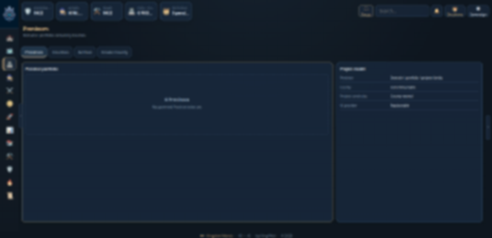
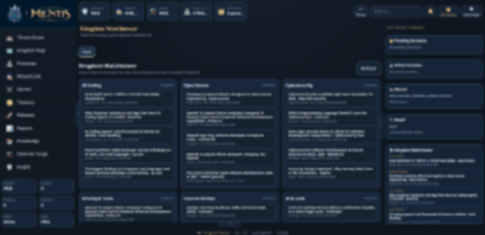
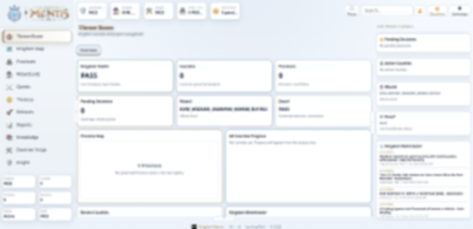
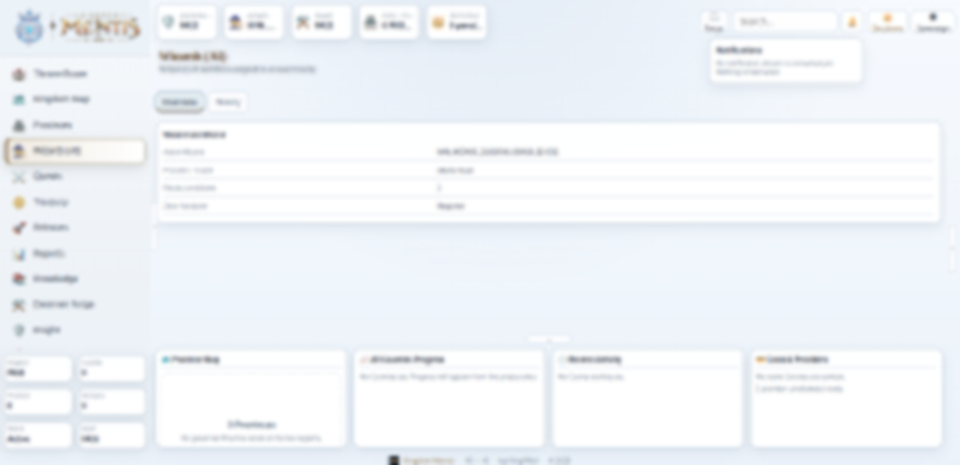

# Kingdom Mentis

**AI-assisted project operating system | KingVMai portfolio**

**Status:** Private Alpha · P15 · Local browser-based prototype · Source code private

[Architecture](docs/ARCHITECTURE.md) · [Validation and limitations](docs/VALIDATION.md)

## Project overview

Kingdom Mentis is an experimental environment for organizing AI-assisted project work with human control. It connects project hierarchy, controlled execution, work status and verification. The aim is to make project decisions and results traceable instead of relying exclusively on long conversations with AI.

## What the prototype demonstrates

- **Project structure:** Kingdom, Province and County hierarchy for organizing work.
- **Local WebApp:** browser-based multi-panel interface with dark and light themes.
- **Governance:** approval gates and authority checks for selected County operations.
- **Controlled execution:** KVM Core and Dwarf performed a disposable task during the KINGOPS13 test.
- **Independent verification:** Knight validation followed by archiving and removal of the temporary County.
- **Project continuity:** private operational state and evidence used to document work and decisions.

## Verified milestone and project status

On **1 October 2026**, the controlled KINGOPS13 lifecycle test completed an authorized task, independent verification and archive-and-destroy processing, leaving no active test County. This is evidence for that particular scenario, not certification of the complete product.

As of **11 November 2026**, Mentis is a **private local prototype in phase P15**. No active real County is recorded. Post-KINGOPS13 hardening remains pending. Cloud First architecture, isolated multi-user accounts and hosted SaaS delivery are future objectives, **not completed features**.

## My contribution and AI's role

**My role:** I developed the concept and product direction, defined requirements, project hierarchy and approval principles, coordinated AI-assisted implementation, reviewed evidence and tested the interface. My work focuses on product ownership, analysis, QA, prioritization, supervision and acceptance decisions.

**AI's role:** AI tools implemented and modified code, executed technical tasks and tests, and prepared technical documentation under my direction. **I do not claim to have personally written the application code.**

**Process:** Requirements → AI implementation → checks and evidence → review → feedback and acceptance.

## Screenshots — local application

Four privacy-anonymized images derived from real local interface screenshots. Fine screen text is deliberately obscured; original captures remain private. The images illustrate the appearance and themes rather than a public working demo.

### Dark theme

| View 1 | View 2 |
| --- | --- |
|  |  |

### Light theme

| View 1 | View 2 |
| --- | --- |
|  |  |

**No videos.** No public interactive demo.

## High-level technical context

Local Python application services and a browser interface using HTML, CSS and JavaScript. Internal governance, task execution and verification are distinct parts of the project. See [architecture](docs/ARCHITECTURE.md) and [validation](docs/VALIDATION.md).

## Repository scope

This is a **documentation-only portfolio**, suitable for sharing in a CV. It contains no application source code, private QuestMaps, secrets, credentials, configuration, personal data, internal logs, original screenshots or downloadable software.

**KingVMai · Project portfolio · 2026**
